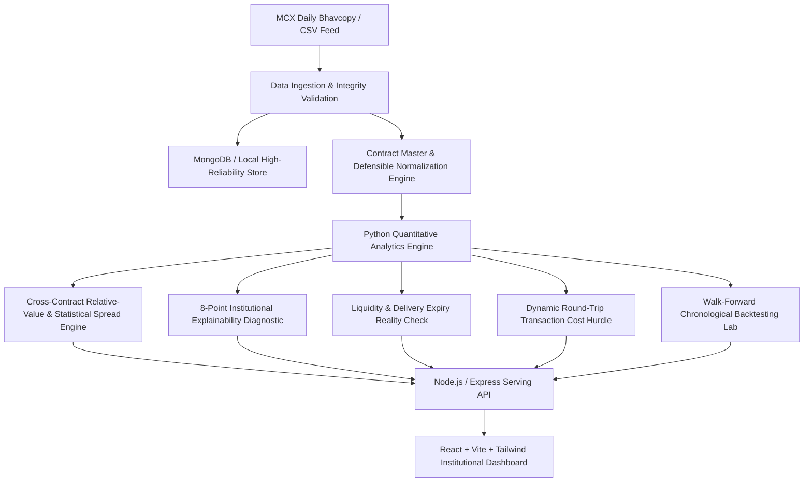

# GOLDX — Explainable Cross-Contract Gold Intelligence

> **Hack in Hills '26** | **Problem Statement 03: Commodity Derivatives Intelligence**  
> **Team:** CodeHimalayan (`Anshika Yadav` — Full-Stack Analytics Lead, `Aniket Kaushik` — Data, Infrastructure and Deployment Lead)  
> **Tagline:** *"From Raw Gold Data to Explainable Intelligence"*

---

## 1. Executive Summary & Problem Formulation

In Indian commodity derivatives (MCX), gold is traded across four standardized futures contracts:
1. **GOLDM (Gold Mini):** 100 grams trading unit, quoted in ₹ per 10 grams (999 fineness).
2. **GOLDTEN (Gold 10g):** 10 grams trading unit, quoted in ₹ per 10 grams (999 fineness).
3. **GOLDGUINEA (Gold Guinea):** 8 grams trading unit (1 sovereign coin), quoted in ₹ per 8 grams (999 fineness).
4. **GOLDPETAL (Gold Petal):** 1 gram trading unit, quoted in ₹ per 1 gram (999 fineness).

### The Challenge
Because quotation units, trading sizes, delivery physical forms (bars vs coins), and liquidity profiles vary dramatically, **raw contract prices cannot automatically be compared like-for-like**. Apparent price differences often represent unit artifacts rather than genuine economic divergence.

### The GOLDX Solution
GOLDX ingests daily MCX Bhavcopy market feeds, validates records with line-by-line integrity diagnostics, normalizes prices onto a common analytical unit (**₹ / 10g of 999 fineness**), computes statistical relative-value measures, identifies historical anomalies through an institutional **8-Point Explainability Diagnostic**, models transaction friction and expiry constraints, and rigorously evaluates analytical rules via **walk-forward backtesting with zero look-ahead bias**.

*GOLDX does not claim guaranteed market predictions or guaranteed profits; it provides defensible, cost-aware, and explainable intelligence for quantitative researchers and commodity analysts.*

---

## 2. System Architecture



### Technology Stack
- **Frontend:** React 19, Vite, Tailwind CSS v4, Lucide Icons, Custom High-Performance Institutional Financial SVG Charting Canvas with tab navigation and crosshairs.
- **Backend:** Node.js, Express.js, Multer (multipart CSV parser), Centralized Error Handling, CORS.
- **Analytics Engine:** Python 3.13, Pandas, NumPy, Scikit-learn, dual-mode persistent HTTP (`http.server` port 5001) & CLI process fallback.
- **Database:** MongoDB with Mongoose (with high-reliability in-memory / local fallback).

---

## 3. Mathematical & Quantitative Framework

### 3.1 Defensible Normalization to Standard Unit (₹ / 10g)
$$\text{NormalizedPrice}(t) = \left( \frac{\text{QuotedPrice}(t)}{\text{QuotationBasis}} \right) \times 10.0 \times \left( \frac{\text{TargetPurity}}{\text{ContractPurity}} \right)$$

- **GOLDM:** Quoted in ₹/10g $\implies$ Multiplier = $1.0\times$
- **GOLDTEN:** Quoted in ₹/10g $\implies$ Multiplier = $1.0\times$
- **GOLDGUINEA:** Quoted in ₹/8g $\implies$ Multiplier = $(10 / 8) = 1.25\times$
- **GOLDPETAL:** Quoted in ₹/1g $\implies$ Multiplier = $(10 / 1) = 10.0\times$

### 3.2 Statistical Relative-Value & Rolling Z-Scores
For any contract pair $(A, B)$ on session $t$:
$$\text{Spread}(t) = P_{\text{norm}, A}(t) - P_{\text{norm}, B}(t)$$
$$\text{PctSpread}(t) = \frac{\text{Spread}(t)}{\frac{P_{\text{norm}, A}(t) + P_{\text{norm}, B}(t)}{2}} \times 100\%$$
$$\mu_W(t) = \frac{1}{W} \sum_{k=1}^W \text{Spread}(t - k), \quad \sigma_W(t) = \sqrt{\frac{1}{W - 1} \sum_{k=1}^W (\text{Spread}(t - k) - \mu_W(t))^2}$$
$$Z(t) = \frac{\text{Spread}(t) - \mu_W(t)}{\sigma_W(t)}$$
*Lookback window $W$ is strictly computed using prior historical observations to prevent look-ahead bias.*

### 3.3 The 8-Point Institutional Diagnostic
Every detected spread dislocation ($|Z| \ge \text{threshold}$) answers:
1. **What did GOLDX observe?** (Exact spread breach in ₹/10g, %, and Z-score).
2. **How was it calculated?** (Exact arithmetic and multipliers applied to raw quotes).
3. **What historical reference was used?** (Lookback window length $W$, historical $\mu$, and $\sigma$).
4. **What assumptions were applied?** (999 fineness parity, physical delivery unit assumptions).
5. **What do liquidity and expiry tell us?** (Volume, open interest, turnover ratio, days to expiry).
6. **Were transaction costs available and included?** (Round-trip friction hurdle vs gross spread).
7. **What are the limitations?** (Coin packaging premiums, lot size mismatches, margin calls).
8. **What additional evidence is required?** (Local spot gold basis in Mumbai/Ahmedabad, COMEX landed parity).

### 3.4 Chronological Walk-Forward Backtesting
- Replays historical test folds chronologically.
- At session $t$, signals are evaluated strictly using statistics calculated up to $t-1$.
- Deducts round-trip statutory costs on every executed signal:
  - Brokerage (0.01%)
  - MCX Exchange charges (0.0021%)
  - Commodity Transaction Tax CTT (0.01% on sell futures turnover)
  - Goods & Services Tax GST (18% on fees)
  - Stamp duty (0.002% on buy turnover)
  - Execution slippage buffer (₹10 - ₹25 per leg)
  - **Estimated Round-Trip Hurdle:** ₹85 - ₹105 per 10 grams.
- Expiry hard cutoff: Exits open positions when $\text{DTE} \le 5$ sessions to avoid physical delivery penalties.

---

## 4. Quick Start & Startup Commands

### Prerequisites
- Node.js (v18+)
- Python (3.11 - 3.14) with `pandas`, `numpy`, `scikit-learn`
- MongoDB (optional, auto-fallback to local in-memory storage)

### Step 1: Clone and Install Dependencies
```bash
# In backend
cd backend
npm install

# In frontend
cd ../frontend
npm install
```

### Step 2: Generate or Verify the Benchmark Demo Dataset
```bash
# Run the deterministic benchmark dataset generator
py -3.13 analytics/generator.py
```
*Generates 1,000 chronological observations across all 4 contracts in `demo-data/mcx_gold_benchmark_demo.csv`.*

### Step 3: Start the Backend & Analytics Engine
```bash
cd backend
npm start
```
*Backend runs on `http://localhost:5000` and automatically connects to MongoDB and initializes the Python Analytics Engine.*

### Step 4: Start the Frontend UI
```bash
cd ../frontend
npm run dev
```
*Frontend opens on `http://localhost:5173`.*

---

## 5. Automated Verification & Testing

To execute the backend integration test suite:
```bash
cd backend
node tests/backend.test.js
```

### Verified Test Results (11 of 11 Passed):
- `GET /api/health` — [PASS]
- `GET /api/contracts` — [PASS]
- `GET /api/datasets` — [PASS]
- `POST /api/datasets/demo` — [PASS]
- `GET /api/datasets/benchmark_demo/quality` — [PASS]
- `GET /api/prices` — [PASS]
- `GET /api/relative-value` — [PASS]
- `GET /api/analytics/anomalies` (8-Point Diagnostic) — [PASS]
- `GET /api/analytics/liquidity` — [PASS]
- `POST /api/backtests/run` (Zero Look-Ahead Bias) — [PASS]
- `GET /api/methodology` — [PASS]

Frontend build verification:
```bash
cd frontend
npm run build
```
*Transforms 1,936 modules with 0 errors.*

---

## 6. REST API Reference

| Endpoint | Method | Description |
|---|---|---|
| `/api/health` | `GET` | System health, Python engine status, MongoDB connectivity |
| `/api/contracts` | `GET` | Contract master specifications (trading units, quotation basis, formulas) |
| `/api/datasets` | `GET` | List active, demo, and user-uploaded datasets |
| `/api/datasets/demo` | `POST` | One-click load deterministic synthetic benchmark dataset |
| `/api/datasets/upload` | `POST` | Upload CSV with auto-alias matching and row-level validation |
| `/api/datasets/:id/quality` | `GET` | Ingestion health score, duplicate and stale check diagnostics |
| `/api/datasets/:id/report` | `GET` | Download full JSON validation report |
| `/api/prices` | `GET` | Normalized time-series price series with applied multipliers |
| `/api/relative-value` | `GET` | Rolling spreads, rolling mean, rolling std, Z-scores, and percentiles |
| `/api/analytics/anomalies` | `GET` | Flagged dislocations with 8-Point Institutional Diagnostic |
| `/api/analytics/liquidity` | `GET` | Volume, open interest, turnover ratio, and days to expiry (DTE) |
| `/api/backtests/run` | `POST` | Chronological walk-forward backtest execution |
| `/api/backtests/:id` | `GET` | Retrieve stored backtest simulation record |
| `/api/methodology` | `GET` | Full methodology documentation and responsible disclosures |

---


## 7. Responsible Analytics Disclaimer

GOLDX is an explainable research prototype created for Hack in Hills '26 Problem Statement 03. It does not provide personalized investment advice or guaranteed market profit predictions. Market participants must assess executable liquidity, physical delivery obligations, and margin requirements independently.
